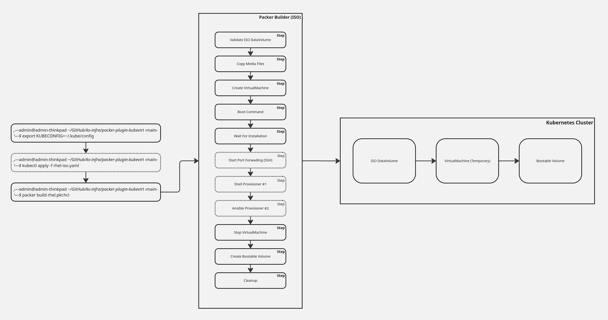

# Packer Plugin KubeVirt

The `KubeVirt` plugin can be used with [HashiCorp Packer](https://www.packer.io) to create KubeVirt images.

## Packer

[Packer](https://developer.hashicorp.com/packer) is a tool for creating identical machine images from a single source template.

To get started, see the [Packer installation guide](https://developer.hashicorp.com/packer/install).

## Prerequisites

- [Packer](https://packer.io)
- [Kubernetes](https://kubernetes.io) with [KubeVirt](https://kubevirt.io) installed

## Plugin Features

- **HCL Templating** – Use HashiCorp Configuration Language (HCL2) for defining infrastructure as code.
- **ISO Installation** – Build VM golden images from ISO using the `kubevirt-iso` builder.
- **ISO Media Files** – Embed additional files, or content rendered by the template, into the installation process (e.g. `ks.cfg` or `unattend.xml`).
- **Boot Command** – Automate the VM boot process using a set of commands (via a VNC connection).
- **Integrated SSH/WinRM Access** – Allows VM provisioning and customization via SSH or WinRM.

## Components

- `kubevirt-iso` - This builder starts from a ISO file and builds virtual machine image on a KubeVirt cluster.
- `kubevirt-clone` - This builder clones an existing virtual machine image and customizes it to produce a modified one.

### Design



## Installation

### Automatic Installation

Packer supports automatic installation of the Packer plugins.

To install this plugin, copy and paste this code into your Packer configuration:

```hcl
packer {
  required_plugins {
    kubevirt = {
      source  = "github.com/hashicorp/kubevirt"
      version = ">= 1.0.1"
    }
  }
}
```

And now run `packer init` command. The plugin will be installed automatically.

### Manual Installation

Download the latest release from the [Releases](https://github.com/hashicorp/packer-plugin-kubevirt/releases) page and then install the plugin:

```shell
$ packer plugins install --path packer-plugin-kubevirt github.com/hashicorp/kubevirt
```

### Building From Source

Clone the repository and build the plugin from the root directory:

```shell
$ go build -ldflags="-X github.com/hashicorp/packer-plugin-kubevirt/version.Version=1.0.1" -o packer-plugin-kubevirt
```

Then install the compiled plugin:

```shell
$ packer plugins install --path packer-plugin-kubevirt github.com/hashicorp/kubevirt
```

## Usage

Refer to the usage guidance in the [examples](./examples/builder/kubevirt-iso) of this plugin.

## Development

### Running Tests

Unit tests run without any external dependencies:

```shell
$ make test
```

### Running Acceptance Tests

Acceptance tests run end-to-end builds against a real Kubernetes cluster. They require:

- A Kubernetes cluster with [KubeVirt](https://kubevirt.io) and [CDI](https://github.com/kubevirt/containerized-data-importer) installed
- [Packer](https://packer.io) installed locally
- `KUBECONFIG` pointing to the cluster

The tests create their own namespaces, import ISO images, build VMs, and clean up all resources automatically.

```shell
# Run all acceptance tests (Linux only)
$ make testacc KUBECONFIG=~/.kube/config

# Run a specific test (e.g. Fedora only)
$ make testacc KUBECONFIG=~/.kube/config TEST=./builder/kubevirt/iso/ TEST_ARGS="-run TestAccISOBuilder_Fedora"

# Include the Windows acceptance test
# By setting `PACKER_ACC_WINDOWS_ACCEPT_EULA=true`, you are agreeing to the
# applicable Microsoft end user license agreement(s) for each deployment or
# installation for the Microsoft product(s).
$ make testacc KUBECONFIG=~/.kube/config PACKER_ACC_WINDOWS_ACCEPT_EULA=true
```

> **Note**: Acceptance tests take a long time to complete (~25 min for Linux, ~45 min for Windows) as they download ISOs and perform full OS installations.

#### Windows ISO URL

The Windows acceptance test imports its installation ISO from a URL. Microsoft
does not offer a stable public URL: the download links it generates are
time-limited (valid for roughly 24 hours), so the test ships with a default URL
that worked at the time of writing and may have since expired.

Override it with the `PACKER_ACC_WINDOWS_ISO_URL` environment variable:

```shell
$ make testacc KUBECONFIG=~/.kube/config \
    PACKER_ACC_WINDOWS_ACCEPT_EULA=true \
    PACKER_ACC_WINDOWS_ISO_URL="https://software.download.prss.microsoft.com/..."
```

To generate a fresh URL, use the `getisourl.py` helper from the
[KubeVirt Tekton tasks](https://github.com/kubevirt/kubevirt-tekton-tasks/blob/main/release/pipelines/windows-efi-installer/getisourl.py)
(requires Python with [Selenium](https://pypi.org/project/selenium/) installed
and a Chrome or Chromium browser available). Download it so you can review it,
then run it:

```shell
$ wget https://raw.githubusercontent.com/kubevirt/kubevirt-tekton-tasks/main/release/pipelines/windows-efi-installer/getisourl.py
$ export PACKER_ACC_WINDOWS_ISO_URL="$(python3 getisourl.py)"
```

## Privacy Notice

Individuals, including external contributors, who participate in this repository and related project activities may have personal information associated with their GitHub profiles, contributions, and repository activity processed for security, compliance, audit, vulnerability management, and related governance purposes.

For more information about how personal information may be collected, used, shared, retained, and the rights available to individuals, please review the [IBM Privacy Statement](https://www.ibm.com/privacy).
