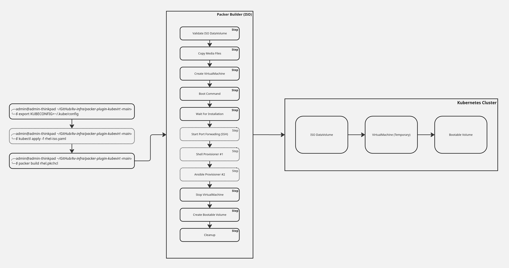

# Packer Plugin KubeVirt

The `KubeVirt` plugin can be used with [HashiCorp Packer](https://www.packer.io) to create KubeVirt images.

## Packer

[Packer](https://developer.hashicorp.com/packer) is a tool for creating identical machine images from a single source template.

To get started, see the [Packer installation guide](https://developer.hashicorp.com/packer/install).

## Prerequisites

- [Packer](https://packer.io)
- [Kubernetes](https://kubernetes.io) with [KubeVirt](https://kubevirt.io) installed

## Plugin Features

- **HCL Templating** – Use HashiCorp Configuration Language (HCL2) for defining infrastructure as code.
- **ISO Installation** – Build VM golden images from ISO using the `kubevirt-iso` builder.
- **ISO Media Files** – Embed additional files, or content rendered by the template, into the installation process (e.g. `ks.cfg` or `unattend.xml`).
- **Boot Command** – Automate the VM boot process using a set of commands (via a VNC connection).
- **Integrated SSH/WinRM Access** – Allows VM provisioning and customization via SSH or WinRM.

## Components

- `kubevirt-iso` - This builder starts from a ISO file and builds virtual machine image on a KubeVirt cluster.

### Design



## Installation

### Automatic Installation

Packer supports automatic installation of the Packer plugins.

To install this plugin, copy and paste this code into your Packer configuration:

```hcl
packer {
  required_plugins {
    kubevirt = {
      source  = "github.com/hashicorp/kubevirt"
      version = ">= 1.0.1"
    }
  }
}
```

And now run `packer init` command. The plugin will be installed automatically.

### Manual Installation

Download the latest release from the [Releases](https://github.com/hashicorp/packer-plugin-kubevirt/releases) page and then install the plugin:

```shell
$ packer plugins install --path packer-plugin-kubevirt github.com/hashicorp/kubevirt
```

### Building From Source

Clone the repository and build the plugin from the root directory:

```shell
$ go build -ldflags="-X github.com/hashicorp/packer-plugin-kubevirt/version.Version=1.0.1" -o packer-plugin-kubevirt
```

Then install the compiled plugin:

```shell
$ packer plugins install --path packer-plugin-kubevirt github.com/hashicorp/kubevirt
```

## Usage

Refer to the usage guidance in the [examples](./examples/builder/kubevirt-iso) of this plugin.

## Privacy Notice

Individuals, including external contributors, who participate in this repository and related project activities may have personal information associated with their GitHub profiles, contributions, and repository activity processed for security, compliance, audit, vulnerability management, and related governance purposes.

For more information about how personal information may be collected, used, shared, retained, and the rights available to individuals, please review the [IBM Privacy Statement](https://www.ibm.com/privacy).
