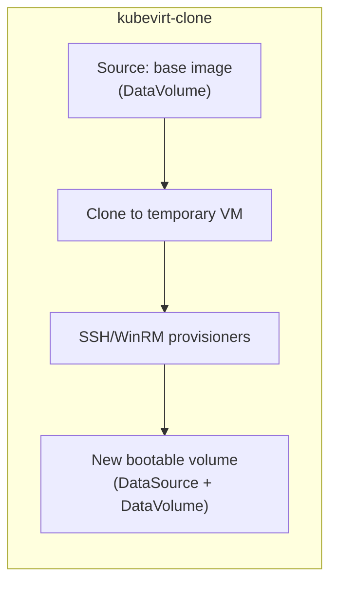

# KubeVirt Clone Builder Design

## Overview

The kubevirt-clone builder creates a customized bootable volume from an existing one. It clones an existing image, modifies it, and creates a new image to use as a bootable volume for another Virtual Machine (VM). It takes a `DataVolume` (DV) as its source, clones it into a temporary VM, runs provisioners to customize the OS, and produces a new DV and `DataSource` (DS).



## User Story

As a system admin, I want to create a new customized bootable volume from an existing volume without requiring OS instalation for each derivative image.

## Goals

- Clone an existing DataVolume into a temporary VM, run provisioners, and produce a new bootable volume (DataVolume + DataSource).
- Reuse the shared builder infrastructure (`common` package) to avoid duplicating steps, config types, and resource helpers.
- Support optional media disks (CD-ROMs) for offline updates or customizations during provisioning.

## Non-Goals

- **In-place modification of the source volume** — the source is never modified. The builder always clones the source DataVolume.
- **Boot command / VNC automation** — the OS is already installed; there is no installer to drive.
- **Windows driver injection** — no VirtIO container disk is attached since the OS and drivers are already installed in the source image.

## Lifecycle

A bootable DV name identifies the source.

The builder follows a clone-then-provision model:

1. **Validate source and target volumes** to check if the source DV and target DS/DV already exist and if the user provided disk size fits the source DV.
2. **Create a temporary VM**. The VM supports optional media disks (CD-ROMs) for offline updates or customizations.
3. **Connect** to the VM through a port forward (SSH or WinRM).
4. **Run provisioners** to customize the OS.
5. **Stop** the temporary VM.
6. **Create a new bootable volume** by creating a new DS and DV from the root disk of the VM.

The source bootable volume is never modified.

## Builder Steps

| Step | Packer Source | Description |
| :---- | :---- | :---- |
| `StepPreValidate` | `common` | Checks if the target volumes exist. |
| `StepValidateVolumeSource` | `clone`  | Checks if the source volume exists and if the user provide disk size  fits the source volume. |
| `StepCopyMediaFiles` | `common` | Creates a ConfigMap with media files and content, attached as a disk to the VM. Skipped when no media is configured. |
| `StepCreateVirtualMachine` | `clone`  | Creates a temporary VM with the cloned DV/PVC root disk. Reuses common VM lifecycle helpers shared with the `kubevirt-iso` builder. |
| `StepStartPortForward` | `common` | Opens a local port forward to the VM for the communicator. |
| `StepConnect` | `packer-sdk` | Connects the SSH or WinRM communicator through the port forward. |
| `StepProvision` | `packer-sdk` | Runs the provisioners configured in the build block. |
| `StepStopVirtualMachine` | `common` | Sets the VM's run strategy to `Halted`. |
| `StepCreateBootableVolume` | `common` | Creates a DS and DV from the root disk of the VM. |

## Configuration

### Shared fields (from `common.BuilderConfig`)

These are embedded via `mapstructure:",squash"` and documented in a common package:

- `kube_config` — path to the kubeconfig file.
- `name` — name for the output bootable volume and temporary VM.
- `namespace` — Kubernetes namespace.
- `instance_type`, `instance_type_kind` — InstanceType for the temporary VM.
- `preference`, `preference_kind` — Preference for the temporary VM.
- `storage_class_name`, `access_mode`, `volume_mode` — storage options.
- `communicator`, `ssh_*`, `winrm_*` — communicator configuration.
- `ssh_local_port`, `winrm_local_port` — port forward configuration.
- `media_files` — paths to files to attach as a media disk to the VM.
- `media_content` — inline file contents for the media disk, supports `templatefile`.
- `media_label` — volume label of the media disk. Defaults to `"OEMDRV"`.
- `disk_bus` — bus type for CD-ROM devices (`"scsi"`, `"sata"`, `"usb"`). Defaults to `"scsi"`.
- `keep_vm` — keep the temporary VM after the build.
- `skip_create_image` — skip creating the final bootable volume.
- `disk_size` — Size of the root disk as a Kubernetes quantity (e.g. `"20Gi"`).

### Clone-specific fields

- `source_volume_name` (string, **required**) — Name of the source DataVolume. This is the bootable volume to clone.
- `source_volume_namespace` (string, optional) — Namespace of the source DataVolume. Defaults to `default`.

The value of these fields can't be equal to `name` and `namespace` values.

### Per-builder fields (block types)

- `networks` — List of networks to attach to the temporary VM. Defined per-builder because `packer-sdc` requires block types in the same package for HCL2 spec generation.

### Fields NOT present (iso-only)

`iso_volume_name`, `boot_command`, `boot_wait`, `installation_wait_timeout`, `os_type`, `virtio_container_image`.

## Example

```hcl
packer {
  required_plugins {
    kubevirt = {
      source  = "github.com/hashicorp/kubevirt"
      version = ">= 1.0.0"
    }
  }
}

variable "kube_config" {
  type    = string
  default = env("KUBECONFIG")
}

source "kubevirt-clone" "customized-fedora" {
  kube_config = var.kube_config
  name        = "fedora-42-customized"
  namespace   = "images"

  # Source: bootable volume 
  source_volume_name = "fedora-42-base"

  # VM configuration
  instance_type = "o1.medium"
  preference    = "fedora"

  disk_size = "20Gi"

  # Optional: attach files for offline updates
  # media_files = ["./offline-updates.rpm"]

  # Communicator
  communicator = "ssh"
  ssh_username = "user"
  ssh_password = "root"
  ssh_timeout  = "10m"
}

build {
  sources = ["source.kubevirt-clone.customized-fedora"]

  provisioner "shell" {
    inline = [
      "sudo dnf install -y nginx",
      "sudo systemctl enable nginx",
    ]
  }
}
```

## VM Resource Construction

The temporary VM differs from the `kubevirt-iso` VM:

1. **Root disk source**: The `DataVolumeTemplate` uses `Source.PVC` to clone from the source DataVolume's backing PVC, instead of `Source.Blank`.
2. **Optional media disk**: When `media_files` or `media_content` is configured, a ConfigMap-backed CD-ROM is attached. Otherwise, the VM has only the root disk.
3. **No ISO disk**: No installation ISO or VirtIO driver disk.

```go
Spec: v1.VirtualMachineSpec{
    RunStrategy: ptr.To(v1.RunStrategyAlways),
    Instancetype: &v1.InstancetypeMatcher{
        Kind: instanceTypeKind,
        Name: instanceType,
    },
    Preference: &v1.PreferenceMatcher{
        Kind: preferenceKind,
        Name: preferenceName,
    },
    DataVolumeTemplates: []v1.DataVolumeTemplateSpec{
        {
            ObjectMeta: metav1.ObjectMeta{
                Name: name + "-rootdisk",
            },
            Spec: cdiv1.DataVolumeSpec{
                PVC: common.PersistentVolumeClaimSpec(diskSize, ...),
                Source: &cdiv1.DataVolumeSource{
                    PVC: &cdiv1.DataVolumeSourcePVC{
                        Name:      sourceVolumeName,
                        Namespace: sourceVolumeNamespace,
                    },
                },
            },
        },
    },
    Template: &v1.VirtualMachineInstanceTemplateSpec{
        Spec: v1.VirtualMachineInstanceSpec{
            Networks: vmNetworks,
            Domain: v1.DomainSpec{
                Devices: v1.Devices{
                    Interfaces: vmInterfaces,
                    Disks:      disks, // rootdisk + optional media CD-ROM
                },
            },
            Volumes: volumes, // rootdisk (from DataVolumeTemplate) + optional media ConfigMap
        },
    },
},
```

## Registration

```go
// main.go
setup.RegisterBuilder("iso", new(iso.Builder))
setup.RegisterBuilder("clone", new(clone.Builder))
```

Users reference it as `kubevirt-clone` in HCL (the plugin name `kubevirt` is prepended by Packer).
